<!-- _class: title cover -->
<div class="cover-brand"></div>

# Future-proof your<br>research workflow with Git
## An introductory workshop

<div class="cover-details">
ODISSEI Early Career Day<br>
4 November 2026 · 13:30–15:45
</div>

<div class="cover-materials">
<a href="https://edu.nl/qe4gw">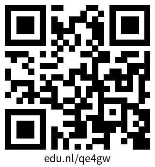</a>
</div>


---
<!-- _class: mission -->
# We help social scientists with data-intensive & computational research

Our goal is to enhance the evidence base and impact of social science by bringing the added value of new data sources and new data analysis techniques into social research in the Netherlands.

---
<!-- _class: team -->
# Who we are

<div class="team-layout">
<div class="team-copy">
<h2>Core team</h2>
<p>Computer and data scientists at postdoc or assistant professor level, with a social sciences background.</p>
<h2>Fellows</h2>
<p>Early career social scientists working on projects aligned with ODISSEI and SoDa’s mission.</p>
<h2>Student and research assistants</h2>
<p>Support SoDa projects and activities.</p>
<h2>Associate members</h2>
<p>Liaisons, including research software engineers from eScience, SCP etc.</p>
</div>
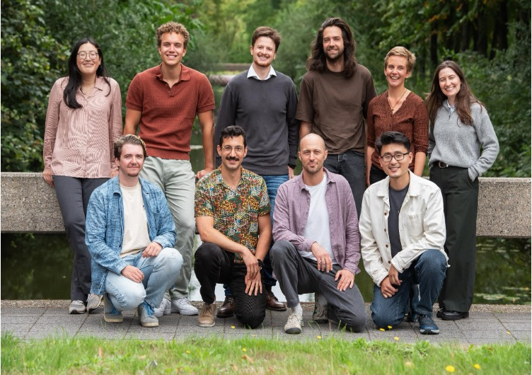
</div>

---
<!-- _class: fellowship -->
# Fellowship programme

<div class="fellowship-layout">
<div>

- **2–3 fellows per year**
- For PhD researchers, postdocs and assistant professors
- Propose your own social science research project
- **3–6 months full-time, with salary paid**
- Join the **SoDa team** at Utrecht University’s Methodology & Statistics department
- Receive mentoring from a senior team member

</div>
<div class="fellowship-deadline">
Next application deadline:<br>
<strong>7 December</strong>
</div>
</div>


---
# Agenda

| Time | Activity |
|:--|:--|
| 13:30–13:40 | Git, GitHub and research files |
| 13:40–14:00 | Repository setup and cloning |
| 14:00–14:25 | Changes, commits, history, push/pull |
| 14:25–14:35 | Break |
| 14:35–14:55 | Branches |
| 14:55–15:30 | Issues, pull requests and peer review |
| 15:30–15:45 | Git and AI-assisted research |


---
# Familiar research project problems

`analysis_final.R` → `analysis_final_v2.R` → `analysis_final_REALLY_FINAL.R`

Or:

- Two collaborators edit the same file and exchange copies by email.
- A result changes, but nobody remembers *which code changed*.
- AI assistants produce changes, but you cannot see what changed (over time).

<br>

> **Git helps you make changes visible, trackable and reversible.**

---
<!-- _header: '' -->
<!-- _footer: '' -->
<!-- _paginate: false -->

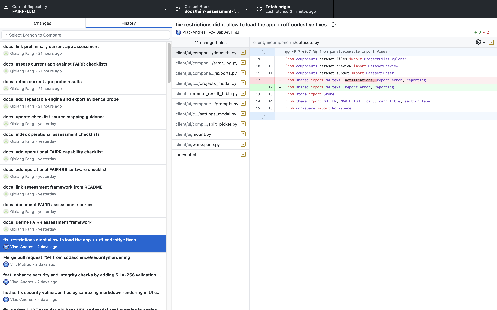

---
# Workshop goals

By the end, you can:

- **Track** changes to a research project.
- **Recover** an earlier version when something goes wrong.
- **Synchronize** work between your computer and GitHub.
- **Work in branches** without disturbing the main version.
- **Propose, review, and merge** a colleague's changes.
- **Understand** how to further integrate Git into your (AI-assisted) research workflow.

> You do not need to write or run code to learn any of these.


---
<!-- _class: foundation -->
# Three different tools
<div class="foundation-core">
<h2>Git</h2>
<p class="foundation-subtitle">The foundation: version control</p>
<p class="foundation-details">History · Commits · Branches · Merges</p>
</div>

<div class="foundation-link"><span>⇅</span>Use Git to work with repositories</div>

<div class="foundation-clients">
<div class="foundation-client">

<div>
<h2>GitHub.com</h2>
<p class="foundation-details">Website: share · review · discuss</p>
</div>
</div>
<div class="foundation-client">
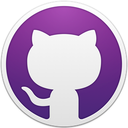
<div>
<h2>GitHub Desktop</h2>
<p class="foundation-details">App on your laptop: commit · push · pull</p>
</div>
</div>
</div>
<div class="foundation-others">Other clients work the same way, e.g. GitLab, VS Code, RStudio, Overleaf</div>


---
<!-- _header: '' -->
<!-- _footer: '' -->
<!-- _paginate: false -->

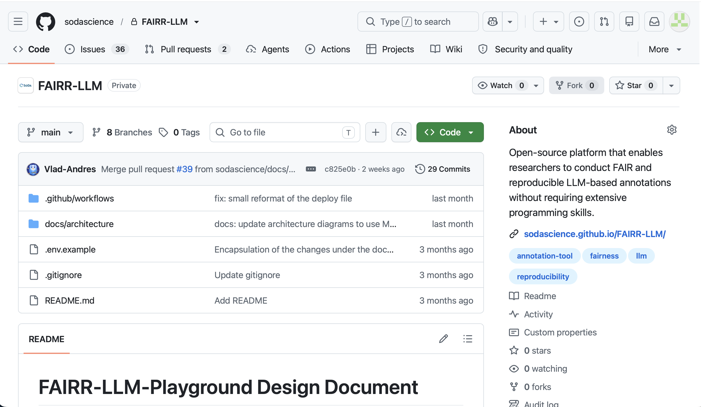

---
<!-- _header: '' -->
<!-- _footer: '' -->
<!-- _paginate: false -->

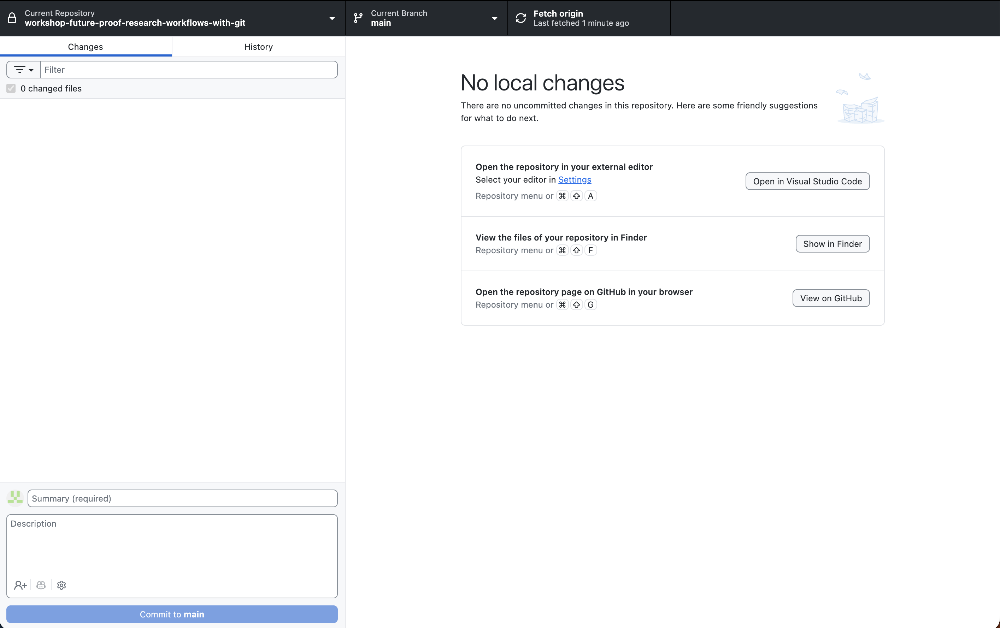

---
<!-- _class: change-steps -->
# A change in three steps

<div class="change-zones">
<div class="change-zone">
<div class="change-zone-title">Your computer</div>
<div class="change-cards">
<div class="change-card"><h2><small>1</small> Edit</h2><p>Change and save a file</p></div>
<div class="change-card"><h2><small>2</small> Commit</h2><p>Record a snapshot with a message</p></div>
</div>
</div>
<div class="change-zone remote">
<div class="change-zone-title">GitHub</div>
<div class="change-cards">
<div class="change-card"><h2><small>3</small> Push</h2><p>Share your commits</p></div>
</div>
</div>
</div>

<div class="change-pull"><strong>Pull</strong> works the other way: bring changes from GitHub to your computer</div>

---
<!-- _class: exercise -->
# Exercise 1 · Your private repository (5 min)

1. Sign in at **GitHub.com** and choose **New repository**.
2. Name it `research-git-practice`.
3. Choose **Private** and **Add a README file**.
4. Click **Create repository**.
5. Check the **Private** label and open `README.md`.

**Goal:** You own a private repository on GitHub.

---
<!-- _header: '' -->
<!-- _footer: '' -->
<!-- _paginate: false -->

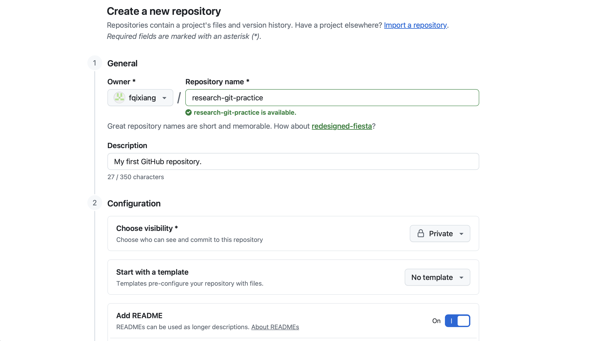

---
<!-- _header: '' -->
<!-- _footer: '' -->
<!-- _paginate: false -->

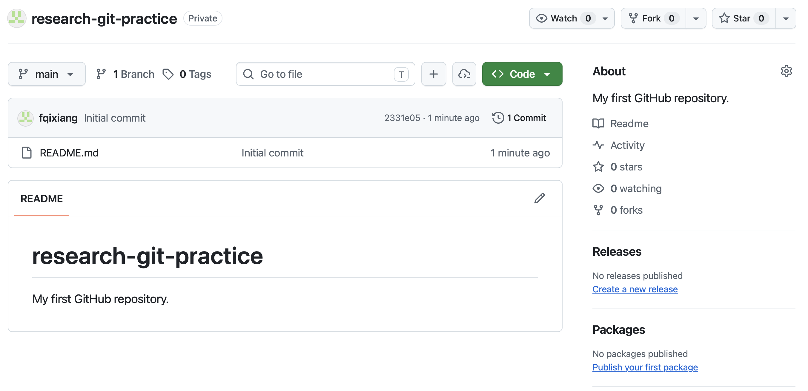

---
# A repository is more than a folder

A **repository** contains:

- Project files: code, documentation, configuration.
- A **history of commits**: what changed, when, and by whom.
- One or more **branches**: different lines of development.


---
# Typical folder structure for a research project

```text
├── .git/            # Local Git history and settings (Git manages this)
├── .github/         # Optional GitHub configurations
├── data/
│   ├── raw/         # Original data (read-only)
│   └── processed/   # Data produced by scripts
├── notebooks/       # Jupyter, R Markdown or Quarto notebooks
├── src/             # Source code and scripts
├── .gitignore       # Rules for excluding untracked files
├── LICENSE.txt      # Project license
└── README.md        # Project overview and documentation
```

Dot-prefixed names may be hidden in your file manager. 


---
<!-- _class: exercise -->
# Exercise 2 · Clone it locally (5 min)

1. On GitHub, open **your** new repository.
2. Click **Code → Open with GitHub Desktop**.
3. Choose where to save the local repository.
4. Click **Clone**.
5. Open the cloned folder in your file manager.

**Check:** Can you find `README.md` on your computer?

---
<!-- _header: '' -->
<!-- _footer: '' -->
<!-- _paginate: false -->

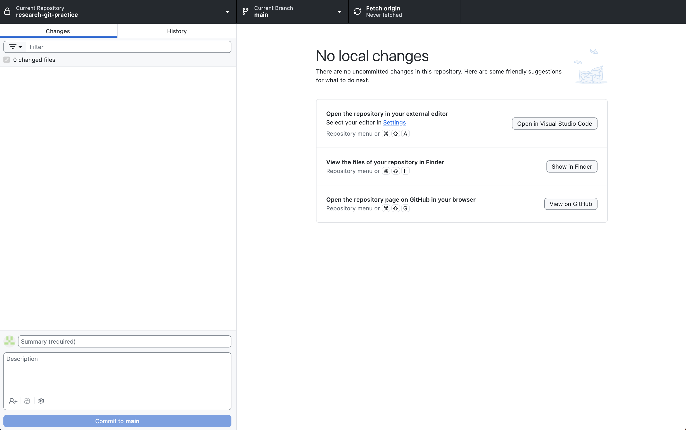

---
<!-- _header: '' -->
<!-- _footer: '' -->
<!-- _paginate: false -->

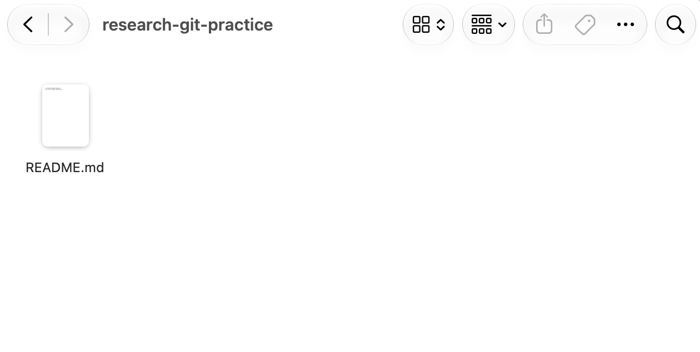

---
<!-- _class: checkpoint -->
# Two places

**On GitHub.com:** your project exists online.

<!-- Maybe mention that it's a normal folder but that has a .git hidden file? That's how github understands that it's a directory and not just a folder. -->
**On your laptop:** the same files exist in a Git repository. 

**In GitHub Desktop:** you can see your local repository.


---
# Three stages of a change

**1. Edit and save** a file → changed working copy

**2. Commit** in GitHub Desktop → recorded local snapshot with a message
> A commit should describe a coherent change, not just “stuff”.

**3. Push** in GitHub Desktop → available on GitHub


---
# Read the diff before committing

**GitHub Desktop → Changes** shows:

- **Green / +:** added lines.
- **Red / −:** removed lines.
- File names: which files changed.

<br>

> Good commit message: "Document missing-data handling"
> Weak commit message: "updates"

---
<!-- _header: '' -->
<!-- _footer: '' -->
<!-- _paginate: false -->

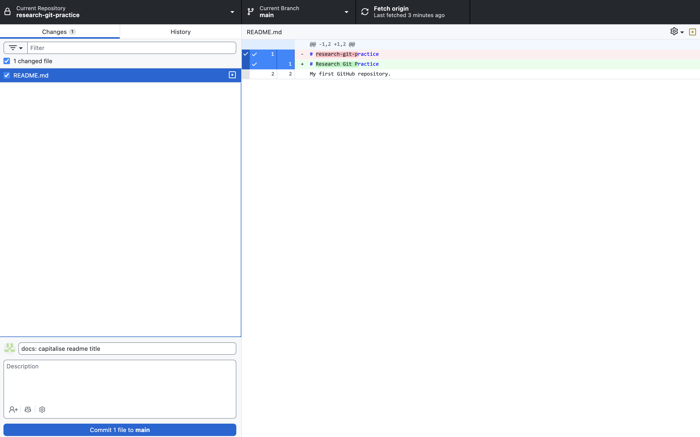

---
<!-- _header: '' -->
<!-- _footer: '' -->
<!-- _paginate: false -->

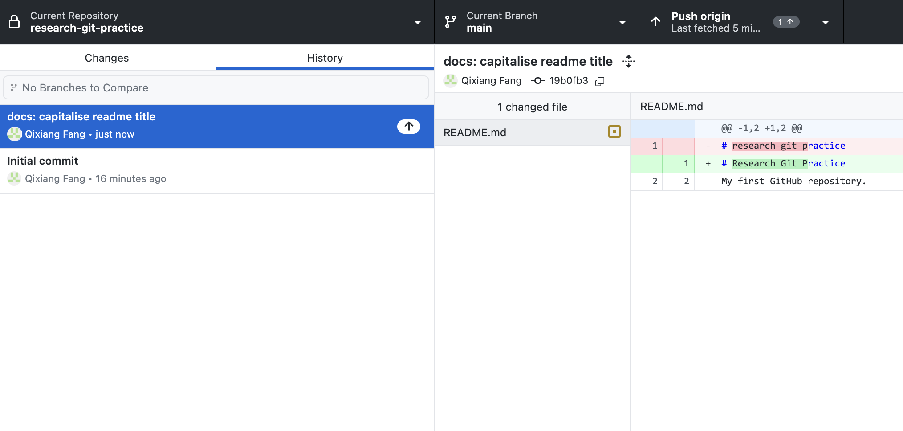

---
<!-- _class: exercise -->
# Exercise 3 · Make your first commits (10 min)

1. Open `README.md` in a **plain-text editor**.
2. Add `## Research question` and one research question based on SORTD.
> What factors influence the number of citations a research publication receives?
3. Create a new file `docs/methods.md`; save.
4. Return to GitHub Desktop → **Changes**.
5. Select README; inspect the diff and describe the change.
6. Click **Commit to main**.
7. Select methods.md; inspect the diff and describe the change.
8. Click **Commit to main**.

**Goal:** Two new commits in your local history.

---
<!-- _header: '' -->
<!-- _footer: '' -->
<!-- _paginate: false -->

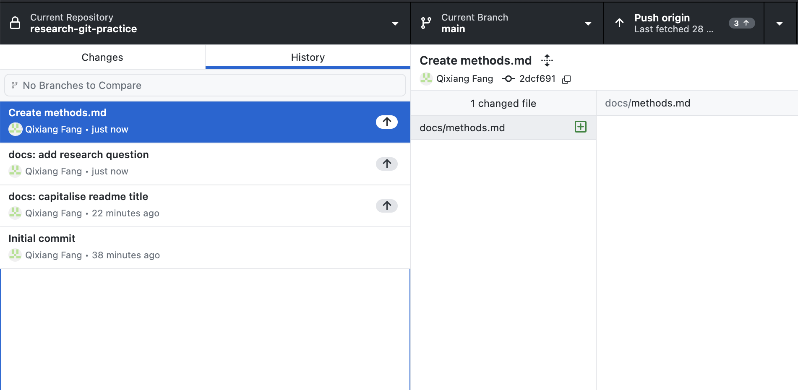

---
# Working with data files

**SORTD = SoDa Open Research Teaching Datasets**: OpenAlex-derived teaching data for exploring research publications.

<div class="qr-center"></div>

1. Create a data folder in your cloned repository `/data`
2. Download the zip file `soda-openalex-teaching-1.0.0.zip` to `/data`

---
<!-- _header: '' -->
<!-- _footer: '' -->
<!-- _paginate: false -->

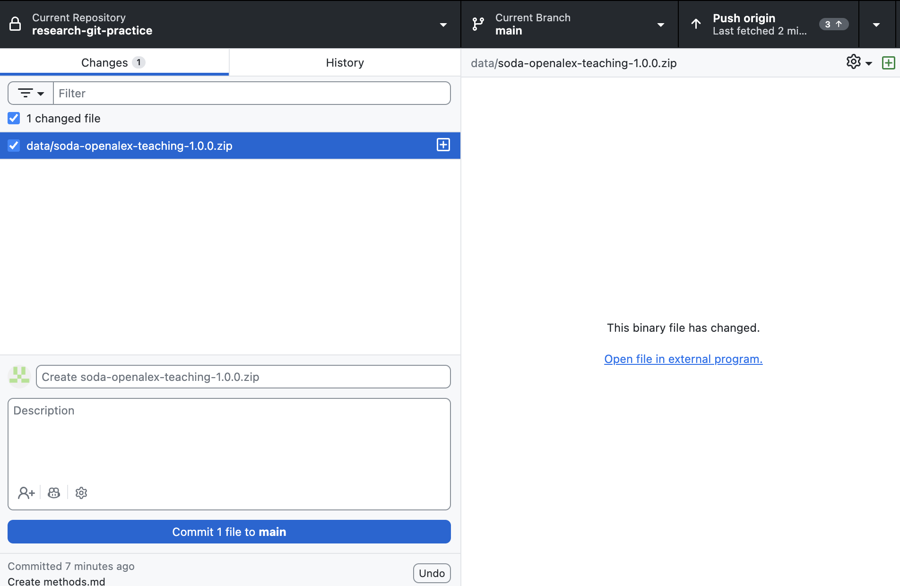


---
# Plain text and binary files

| Plain text | Binary formats |
|:--|:--|
| `.md`, `.R`, `.py`, `.csv`, `.tex` | `.docx`, `.xlsx`, `.pdf`, images |
| Git can show changes line by line | Usually no useful line-by-line diff |
| Easier to review and merge | Often need the original application |

Git can store both. **Readable diffs make collaboration easier.**

---
# Do we want to commit the zip file? Why (not)?


---
# What should be committed?

**Usually yes**

- Analysis scripts and notebooks (when appropriate)
- README and methods documentation
- Small configuration files and environment definitions

**Usually no**

- Confidential or personal research data
- API keys, passwords, credentials
- Large generated datasets or temporary output files

> **Important:** Deleting something in a later commit does not reliably erase it from Git history.


---
# .gitignore

A text file that tells git which files/folders to ignore.

---
# Thou shall not commit these files

1. In your cloned folder, create `.gitignore`.

2. Put these lines in `.gitignore`:

```gitignore
/data/
/output/
.env
.DS_Store
```

---
<!-- _header: '' -->
<!-- _footer: '' -->
<!-- _paginate: false -->

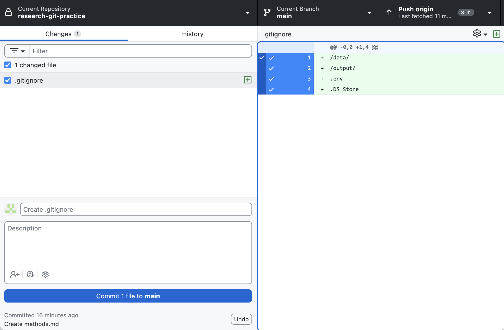

---
<!-- _class: exercise -->
# Exercise 4 · Publish (5 min)

1. In GitHub Desktop, click **Push origin**.
2. Open the repository on GitHub.com.
3. Confirm the new README text and two new files are there.
4. Confirm the new commit history also appears.

---
<!-- _header: '' -->
<!-- _footer: '' -->
<!-- _paginate: false -->

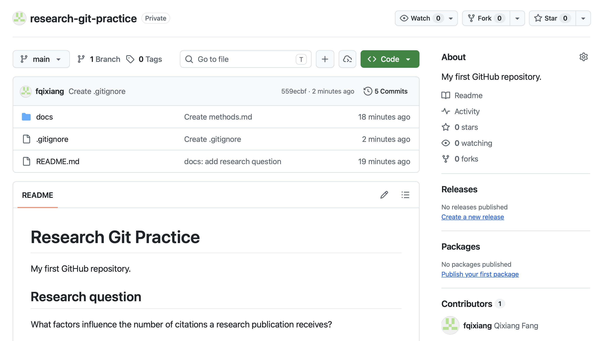

---
<!-- _header: '' -->
<!-- _footer: '' -->
<!-- _paginate: false -->

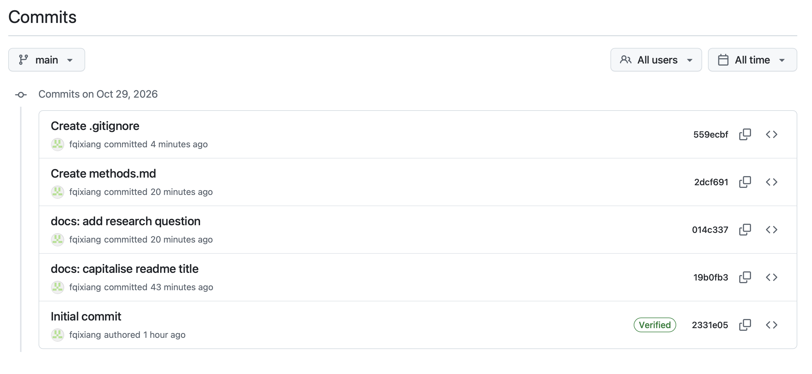


---
<!-- _class: exercise -->
# Exercise 5 · A remote edit and a pull (5 min)

1. On GitHub.com, open `README.md` and click the pencil.
2. Add `Workshop practice: 4 November 2026`.
3. Choose **Commit changes** directly to `main` for this solo exercise.
4. In Desktop, click **Fetch origin**, then **Pull origin**.
5. Open the local README and find the new line.

**Check:** The browser commit now appears in Desktop's History.

---
<!-- _header: '' -->
<!-- _footer: '' -->
<!-- _paginate: false -->

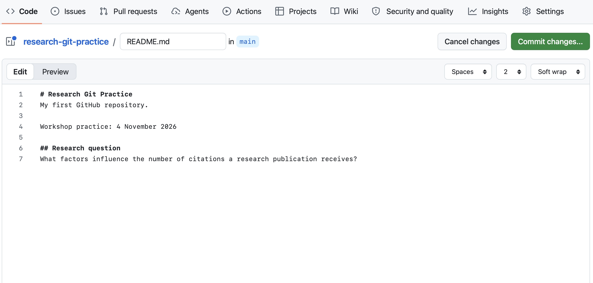

---
<!-- _header: '' -->
<!-- _footer: '' -->
<!-- _paginate: false -->

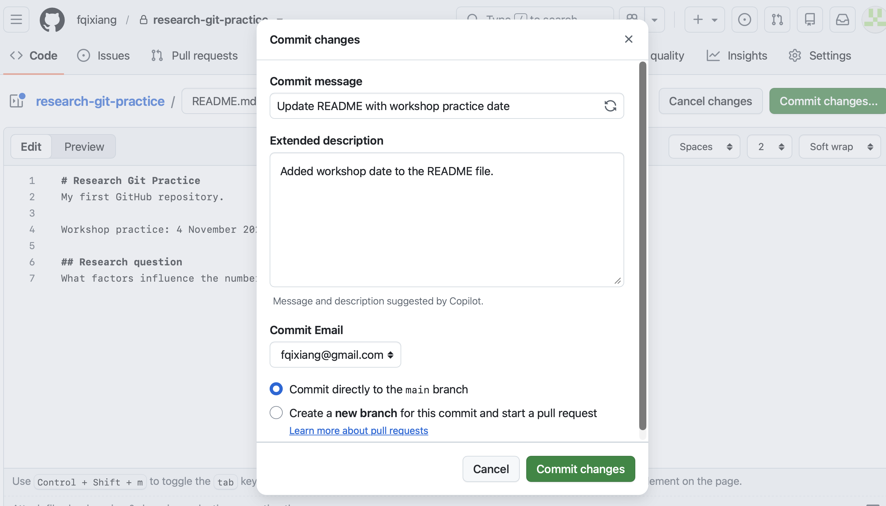

---
<!-- _header: '' -->
<!-- _footer: '' -->
<!-- _paginate: false -->

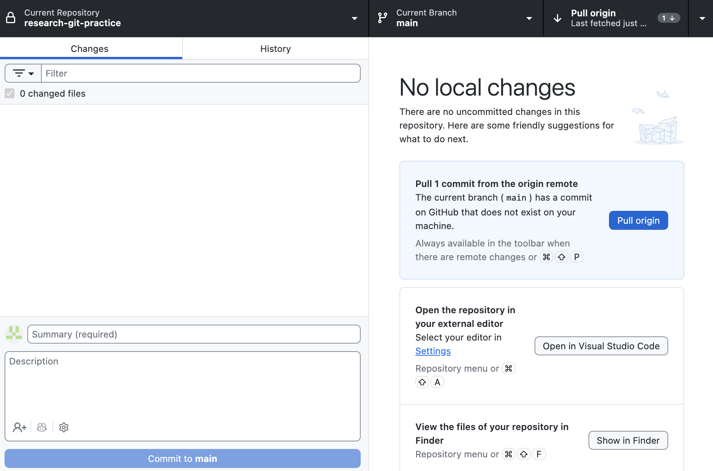


---
<!-- _header: '' -->
<!-- _footer: '' -->
<!-- _paginate: false -->

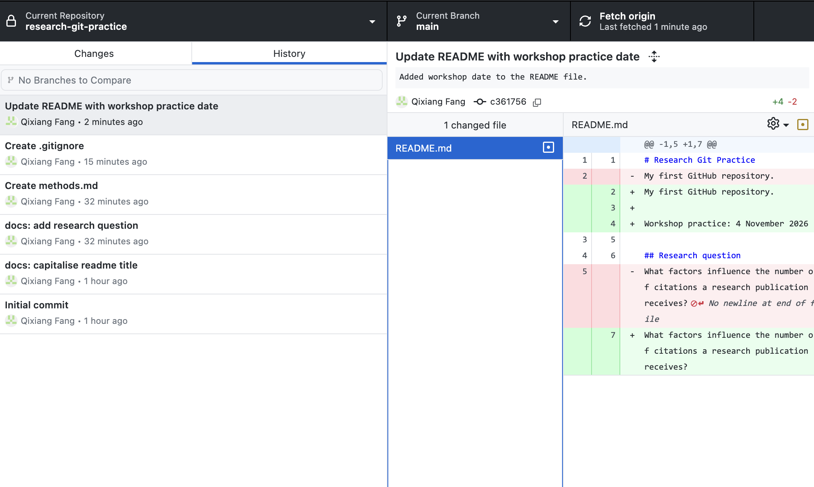

---
# Undoing changes

- **Discard uncommitted edit:** 
     - Gone is gone
     - Discard selected changes only if you truly don't need them.
- **Revert previously committed change:** 
     - Use **History → Revert Changes in Commit** to make a new commit that reverses it.

---

<!-- _class: checkpoint -->
# Quiz · Which action?

1. Your edit is saved but absent from History. What comes next?
2. Your commit is local. How do you send it to GitHub?
3. Your colleague made some changes online. How do you update locally?
4. A committed change was wrong. How can you reverse it visibly?


---
<!-- _class: checkpoint -->
# Quiz · Answers

1. **Review the diff and commit.**
2. **Push.**
3. **Fetch, then pull.**
4. **Revert the commit**, then push the new commit.


---
<!-- _class: title -->
# Break · 14:25–14:35

**Next:** Collaboration workflows with branches, issues, and pull requests.

---
<!-- _header: '' -->
<!-- _footer: '' -->
<!-- _paginate: false -->


---
# What is a branch?

A **branch** is a separate line of development in the *same* repository.

- `main` = the shared, stable line.
- `docs/add-reproducibility-note` = work in progress.
- Changes can be reviewed **before** being merged into `main`.

```text
main:      A ── B ─────────── E
                \           /
new branch:      C ── D ──┘
```

**Branch ≠ separate repository.**

---
<!-- _class: workflow-full -->
<!-- _header: '' -->
<!-- _footer: '' -->
# One week workflow example

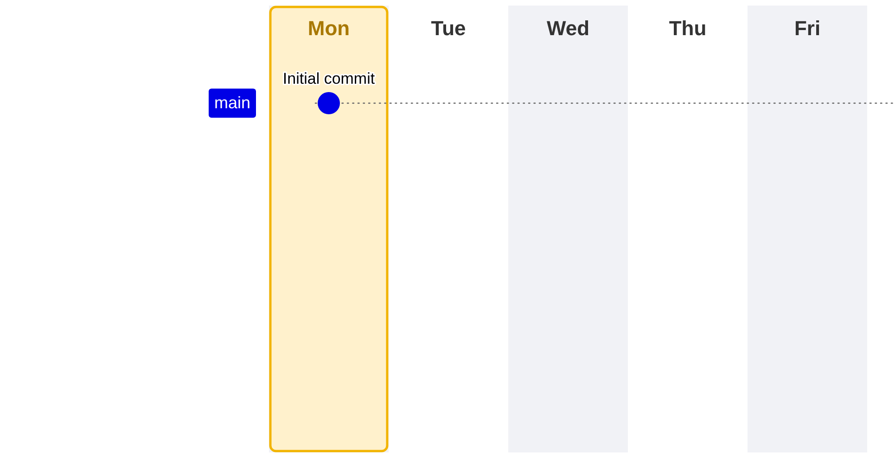

Project set up: first commit with README and methods on main

---
<!-- _class: workflow-full -->
<!-- _header: '' -->
<!-- _footer: '' -->
# One week workflow example

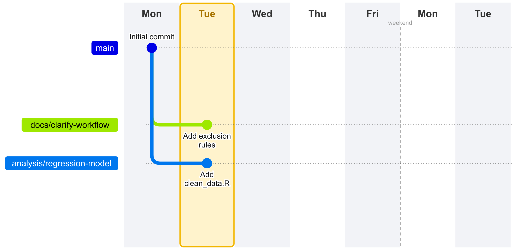

Work splits into branches: exclusion rules and a data-cleaning script

---
<!-- _class: workflow-full -->
<!-- _header: '' -->
<!-- _footer: '' -->
# One week workflow example

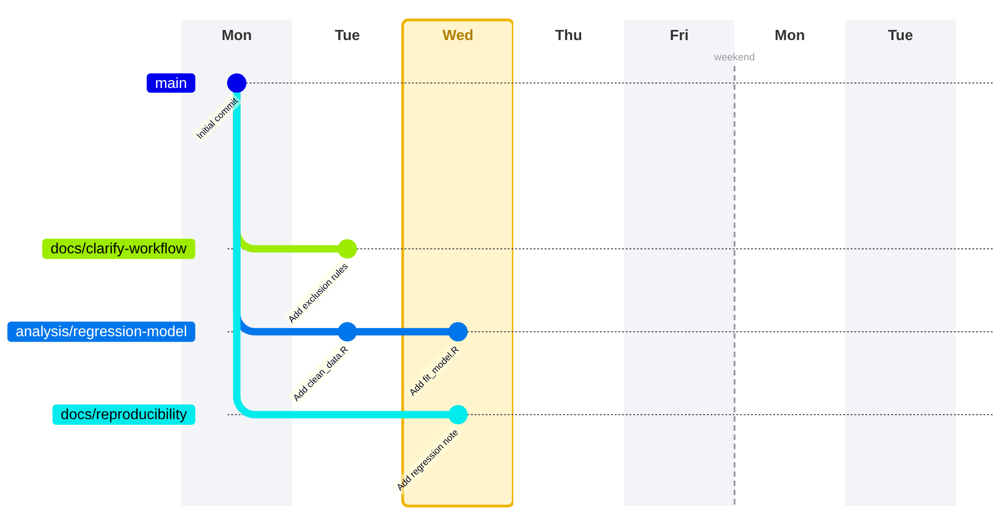

Regression model fitted in R; the approach documented on its own branch

---
<!-- _class: workflow-full -->
<!-- _header: '' -->
<!-- _footer: '' -->
# One week workflow example

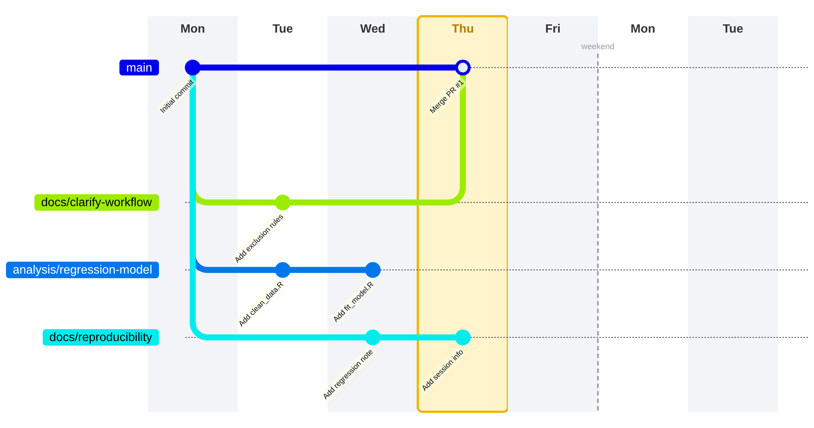

Session info recorded; exclusion rules reviewed and merged (PR #1)

---
<!-- _class: workflow-full -->
<!-- _header: '' -->
<!-- _footer: '' -->
# One week workflow example

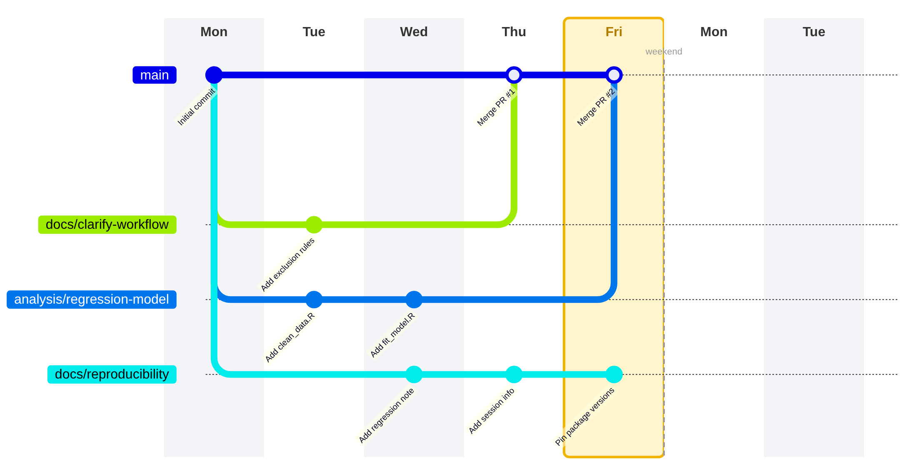

Package versions pinned; R analysis reviewed and merged (PR #2)

---
<!-- _class: workflow-full -->
<!-- _header: '' -->
<!-- _footer: '' -->
# One week workflow example

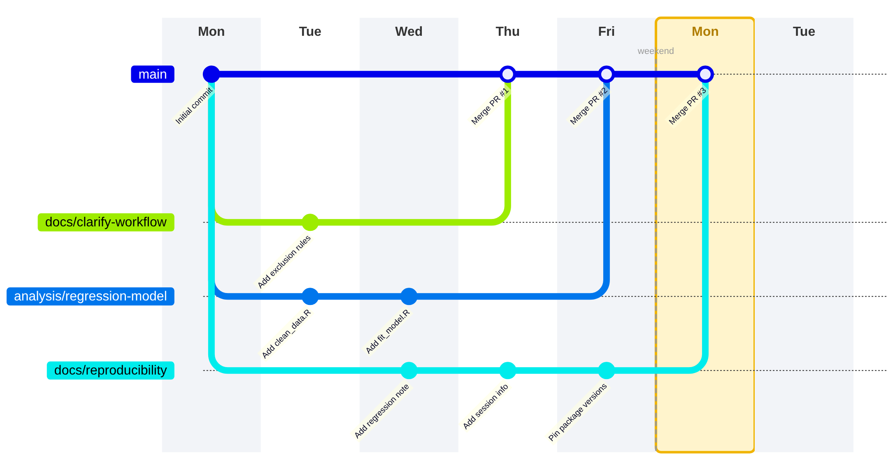

After the weekend: reproducibility docs merged (PR #3)

---
<!-- _class: workflow-full -->
<!-- _header: '' -->
<!-- _footer: '' -->
# One week workflow example

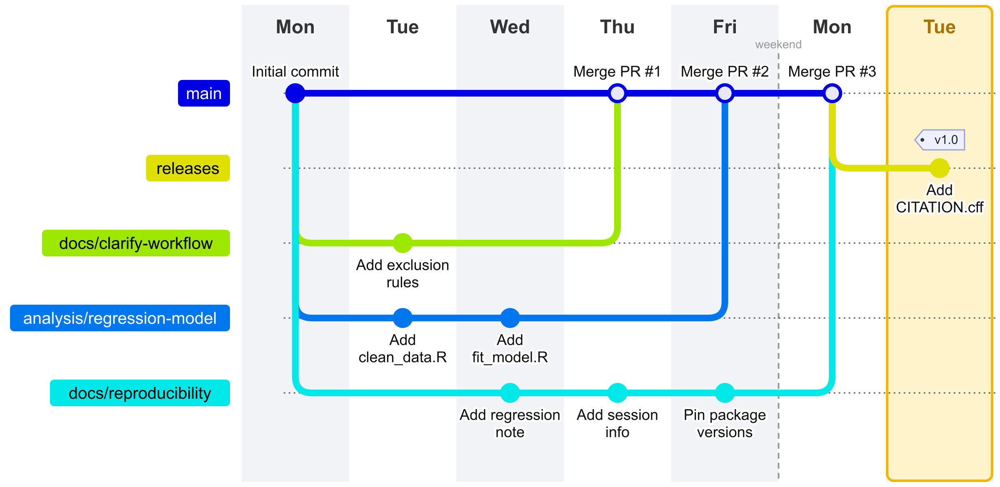

Release branch tagged v1.0, with a CITATION.cff so others can cite it

---
<!-- _header: '' -->
<!-- _footer: '' -->
<!-- _paginate: false -->

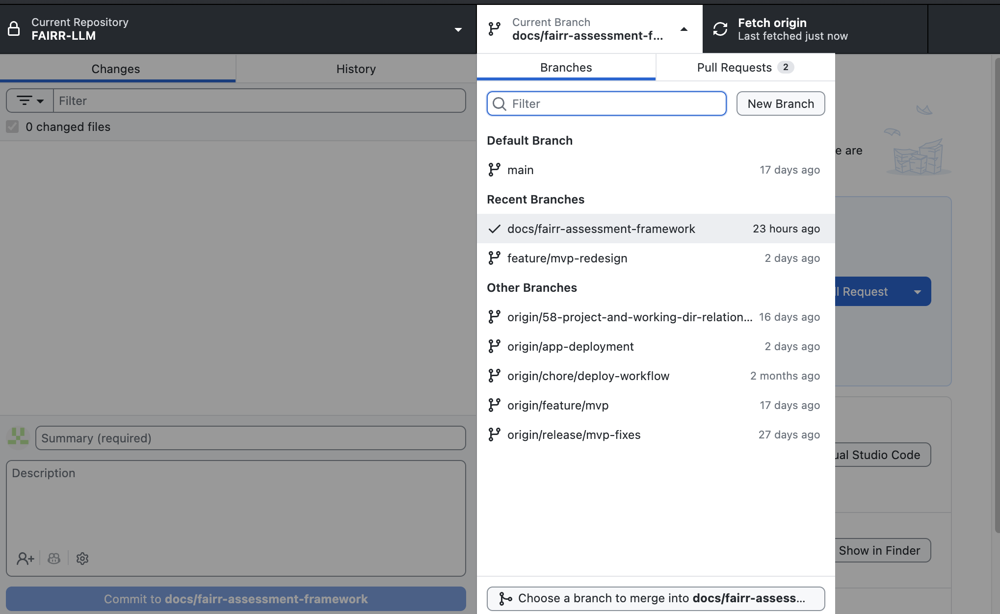

---
# Branching in GitHub Desktop

1. Start from an up-to-date **main** branch.
2. Click **Current Branch → New Branch**.
3. Give it a descriptive name.
4. Edit, review, and **commit** as usual.
5. **Publish branch** to share it on GitHub.

**Switching branches** changes which version of your project you are working on.

---
<!-- _header: '' -->
<!-- _footer: '' -->
<!-- _paginate: false -->


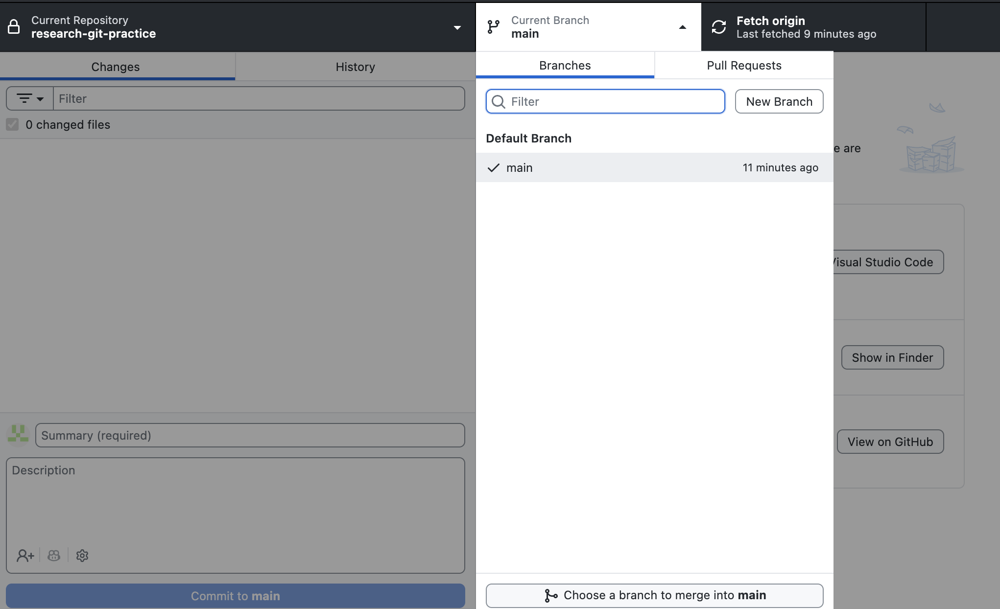

---
<!-- _class: exercise -->
# Exercise 6 · Work on a branch (10 min)

1. In GitHub Desktop, select `main`.
2. Create `docs/reproducibility-note`.
3. Open `docs/methods.md` and add one sentence about documentation.
> The project uses the SoDa SORTD datasets.
4. Review the diff and **commit**.
5. Click **Publish branch**.
6. On GitHub, verify both branches exist.

<br>

---
<!-- _class: checkpoint -->

# Quiz

Does `main` contain your branch’s new sentence yet?


---
<!-- _class: checkpoint -->
# Quiz · Answer

**No.** Your change is on the new branch.

- A branch lets you develop a proposed change independently.
- The change is **not yet in `main`**.
- The branch is now visible on GitHub because you **published** it.

<br>

**How does a colleague decide whether to incorporate it?**

> Next: an issue and a pull request.


---
# Two GitHub collaboration tools

**Issue = work to be done**

> “Document which observations are excluded from the analysis.”

**Pull request (PR) = proposed change to review and merge**

> “I updated `docs/methods.md` to clarify exclusion rules.”

**Typical sequence:** Issue → branch → commits → PR → review → merge.

---
# Research collaboration scenario

**Person A = repository owner**
- Opens a GitHub issue. 
- Shares access with Person B to their `research-git-practice` repository.

**Person B = contributor / author**

- Clones A's repository.
- Makes a change on a **new branch**.
- Opens a pull request.

**Person A = reviewer**

- Reviews the proposal and merges it.

**Both:** Update the local `main` after the merge.


---
<!-- _header: '' -->
<!-- _footer: '' -->
<!-- _paginate: false -->

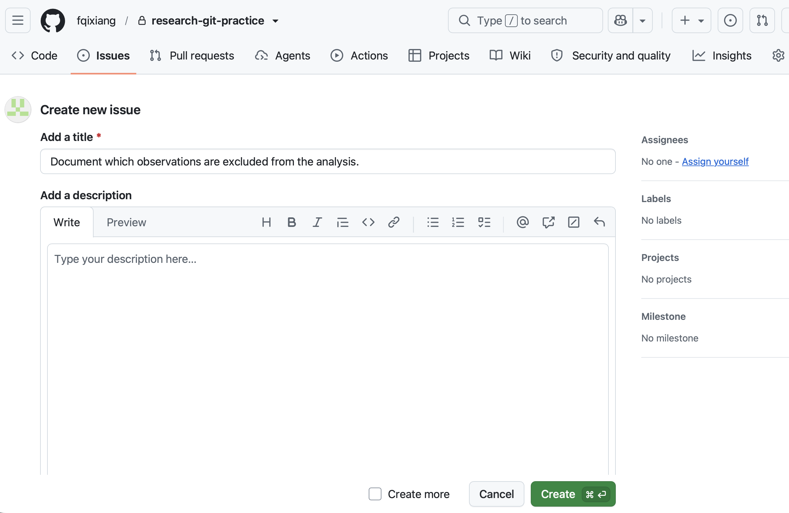

---
<!-- _header: '' -->
<!-- _footer: '' -->
<!-- _paginate: false -->

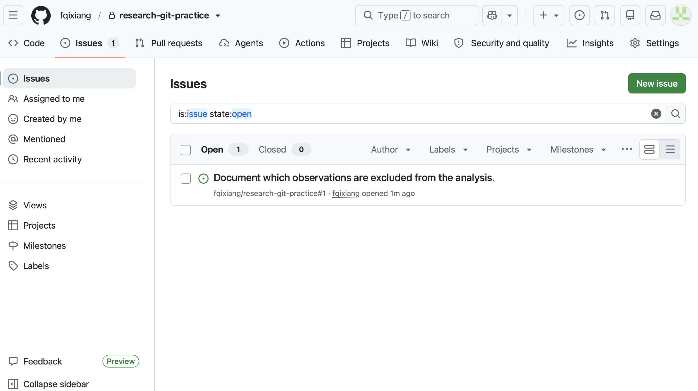

---
<!-- _header: '' -->
<!-- _footer: '' -->
<!-- _paginate: false -->

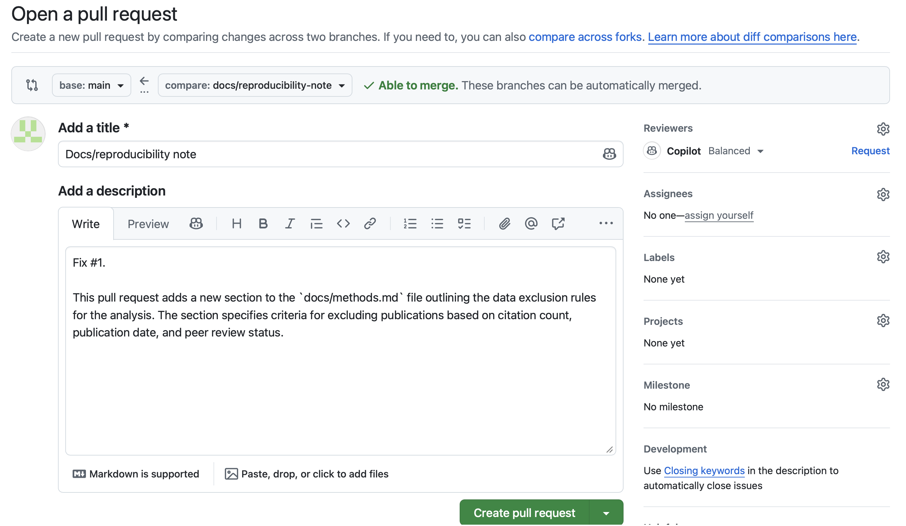

---
<!-- _header: '' -->
<!-- _footer: '' -->
<!-- _paginate: false -->

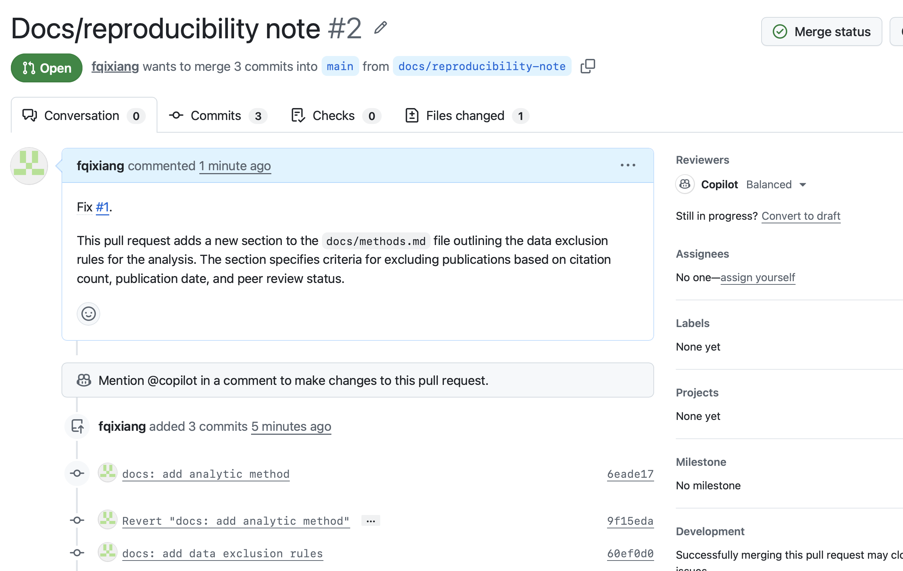

---
<!-- _header: '' -->
<!-- _footer: '' -->
<!-- _paginate: false -->
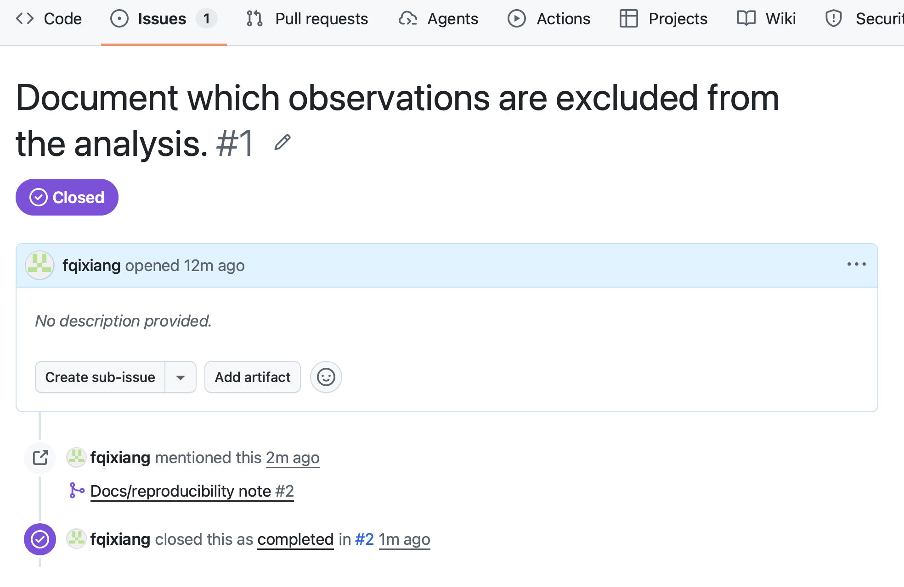

---
<!-- _class: exercise -->
# Exercise 7A · Share and plan (5 min)

**Person A:**


1. On your repository: **Settings → Collaborators → Add people**.
2. Invite Person B's GitHub username.

**Person B:** 

3. Accept the invitation, then **clone A's repository**.

**Person A:**

4. Open a GitHub issue:
> “Add a sentence explaining what statistical methods are used in the analysis.”
5. Assign the issue to Person B.


---
<!-- _class: exercise -->
# Exercise 7B · Propose a change (10 min)

**Person B:**

1. On A's cloned repository, start from **main**.
2. Create branch `docs/clarify-methods`.
3. Add a sentence to `docs/methods.md`.
> "The project uses linear regression."
4. Review the diff → **Commit** → **Publish branch**.
5. Click **Preview/Create Pull Request** in Desktop.
6. On GitHub, open a PR **into `main`**; mention the issue ("Fix #1").

**Do not merge your own PR yet.**


---
<!-- _class: exercise -->
# Exercise 7C · Review, merge, synchronize (5 min)

**Person A:**

1. On GitHub, open B's PR → **Files changed**.
2. Leave a comment or **Approve** the change.
3. **Merge pull request** into `main`.

**Both people:**

4. In GitHub Desktop, **switch to `main`**.
5. **Fetch origin → Pull origin** (when offered).
6. Confirm the new sentence appears locally.


---
<!-- _class: checkpoint -->
# What happened?

Person B did **not** overwrite A's work.

Instead, B:

1. Proposed a change on a branch.
2. Made the diff visible in a pull request.
3. Received review.
4. Had the change merged into `main`.


---
# What should a reviewer check?

Before merging research code or documentation:

- **Purpose:** What is this change supposed to achieve?
- **Scope:** Were only the intended files edited?
- **Diff:** What lines were added or removed?
- **Evidence:** If code changed, was it run or tested?
- **Risks:** Any confidential data, passwords, or unintended outputs?

> A green “Merge” button is not proof of correctness.


---
<!-- _class: checkpoint -->
# Quiz

What can a pull request show that an emailed file cannot?


---
<!-- _class: checkpoint -->
# Quiz · Answer

A pull request connects the proposed **diff** with:

- The reason for the change and its issue.
- Comments and review decisions.
- The commits and the eventual merge into `main`.

<br>

> **Both collaborators then pull the shared version.**


---
# Daily workflow for a research project

```text
PULL latest main
     ↓
CREATE/CHOSE a issue that you plan to work on
     ↓ 
CREATE a branch for one coherent change
     ↓
EDIT → REVIEW DIFF → COMMIT
     ↓
PUSH / PUBLISH branch
     ↓
OPEN PR → DISCUSS / REVIEW → MERGE
     ↓
PULL updated main
```

You now know the essentials of this workflow.


---
<!-- _class: checkpoint -->
# The five things to remember

1. **Commit**: record a meaningful local change.
2. **Push / Pull**: synchronize with GitHub.
3. **Branch**: keep new work separate from `main`.
4. **Pull request**: propose and review a change.
5. **History / Revert**: understand and recover prior work.

> **Git supports reproducibility; it does not guarantee it.**


---
<!-- _class: title -->
# Supercharge your research workflow
- AI-assisted coding
- AI-assisted writing


---
<!-- _header: '' -->
<!-- _footer: '' -->
<!-- _paginate: false -->

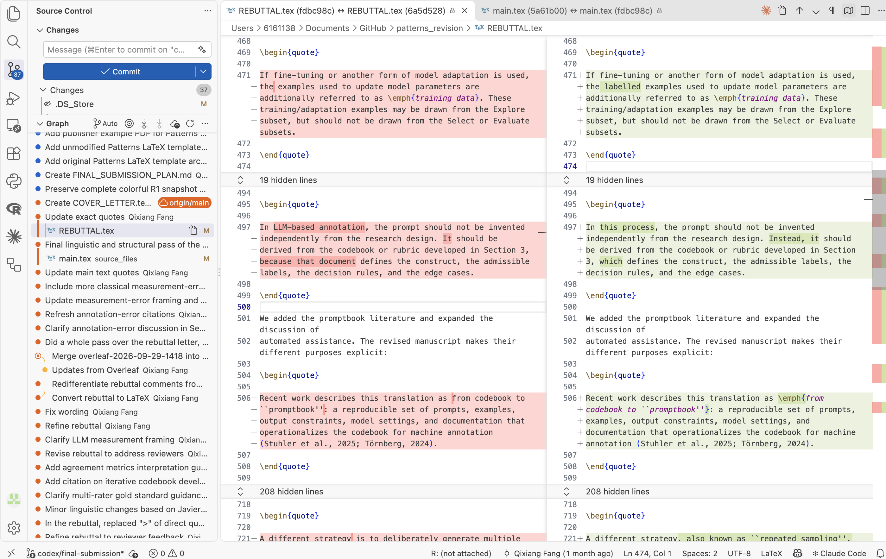

---
<!-- _class: optional -->
# AI-assisted changes in general

If an AI assistant makes any change to your file(s), you should:

- **Make a plan**: what is the intended change?
- **Branch first** so the proposal is isolated.
- **Review the diff**: which files and lines changed?
- **Test / inspect outputs** before accepting the result.
- **Commit meaningful units** rather than a giant opaque change.
     
> Git records changes; **you** remain responsible for research validity.


---
<!-- _class: optional -->
# Git with your coding tools

**You learned Git through GitHub Desktop.**

The same repository can also be managed using:

- VS Code's built-in Source Control interface
- RStudio's Git pane
- Git in a terminal

**Same concepts:** repo, commit, branch, push, pull, merge.


---
<!-- _class: optional -->
# Writing research papers with Git

The same workflow can version-control:

- LaTeX source (`.tex`) and bibliographies (`.bib`)
- Manuscript figures and tables generated by code
- Revisions, comments, and writing contributions

Can be especially useful for:

- **Git + AI integration**
- **Overleaf + Git integration**

---
<!-- _header: '' -->
<!-- _footer: '' -->
<!-- _paginate: false -->

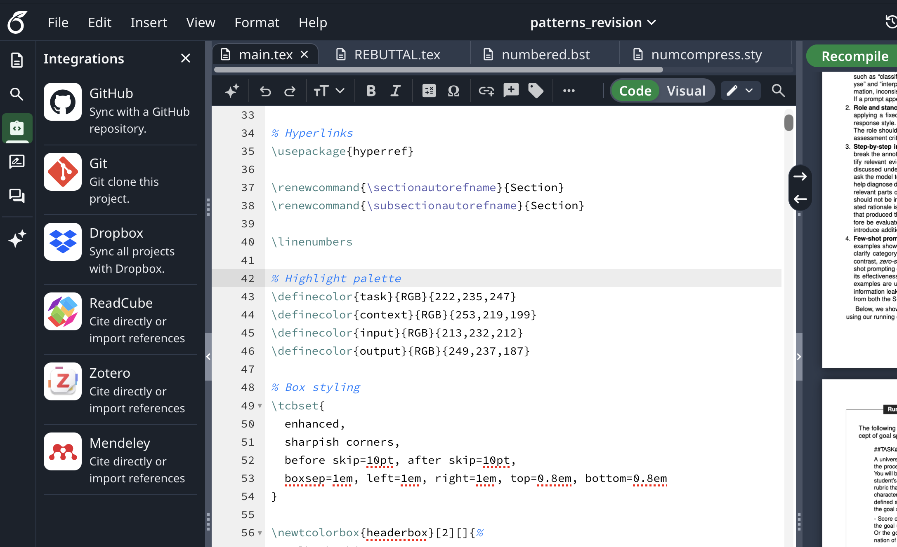

---
<!-- _class: optional small -->
# Useful official guides

- [Getting started with GitHub Desktop](https://docs.github.com/en/desktop/overview/getting-started-with-github-desktop)
- [Cloning a repository](https://docs.github.com/en/desktop/adding-and-cloning-repositories/cloning-a-repository-from-github-to-github-desktop)
- [Creating a PR from Desktop](https://docs.github.com/en/desktop/working-with-your-remote-repository-on-github-or-github-enterprise/creating-an-issue-or-pull-request-from-github-desktop)
- [Inviting collaborators](https://docs.github.com/en/repositories/managing-your-repositorys-settings-and-features/repository-access-and-collaboration/inviting-collaborators-to-a-personal-repository)
- [Reviewing pull requests](https://docs.github.com/en/pull-requests/how-tos/review-pull-requests/reviewing-proposed-changes-in-a-pull-request)
- [Reverting commits](https://docs.github.com/en/desktop/managing-commits/reverting-a-commit-in-github-desktop)
- [Carpentries: GitHub without the command line](https://carpentries-incubator.github.io/github-without-command-line/)


---
<!-- _class: optional -->
# Optional · When Git gets complicated

**Merge conflict** = two sets of changes cannot be reconciled automatically.

Common prevention habits:

- Pull before starting new work.
- Keep branches and pull requests focused.
- Coordinate when editing the same lines.
- Review conflicts carefully; never choose an option blindly.

There is no need to master conflict resolution today.

---
<!-- _class: optional -->
# What do the Git commands look like?

| GitHub Desktop action | Command-line equivalent |
|:--|:--|
| Clone | `git clone URL` |
| Review status | `git status` |
| Record a change | `git add …` then `git commit -m "…"` |
| Send changes | `git push` |
| Retrieve/merge remote changes | `git pull` |
| Create and switch branch | `git switch -c branch-name` |

**These are optional ways to perform the same tasks.**


